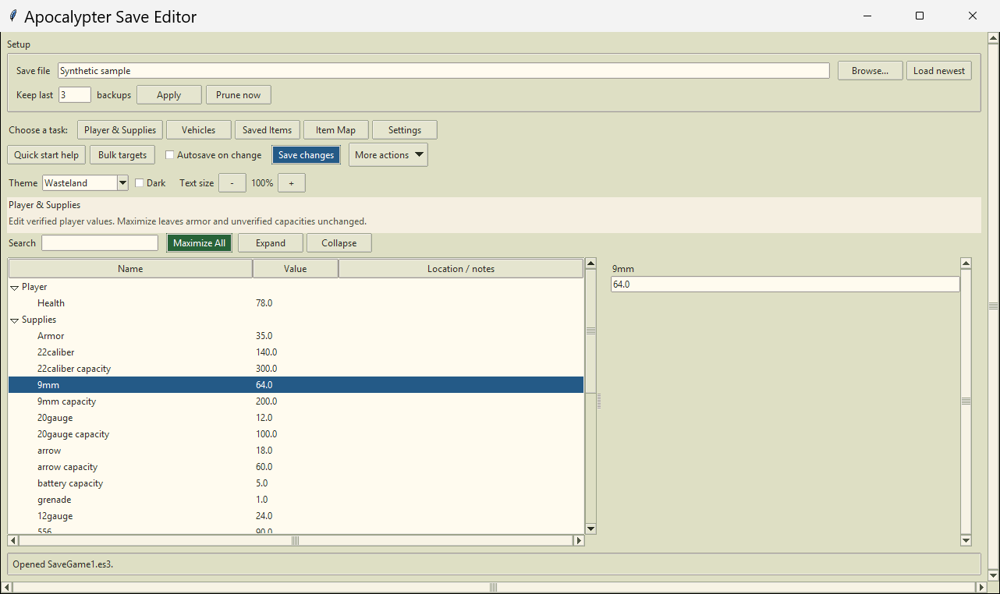
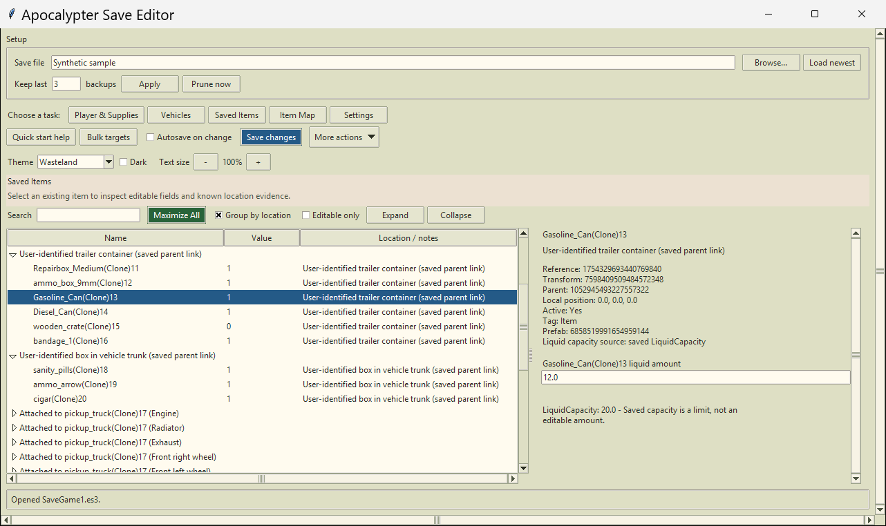
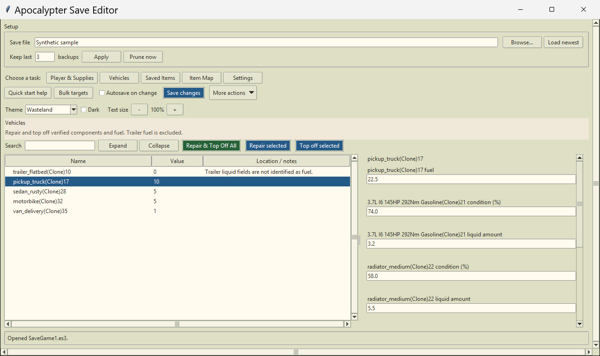
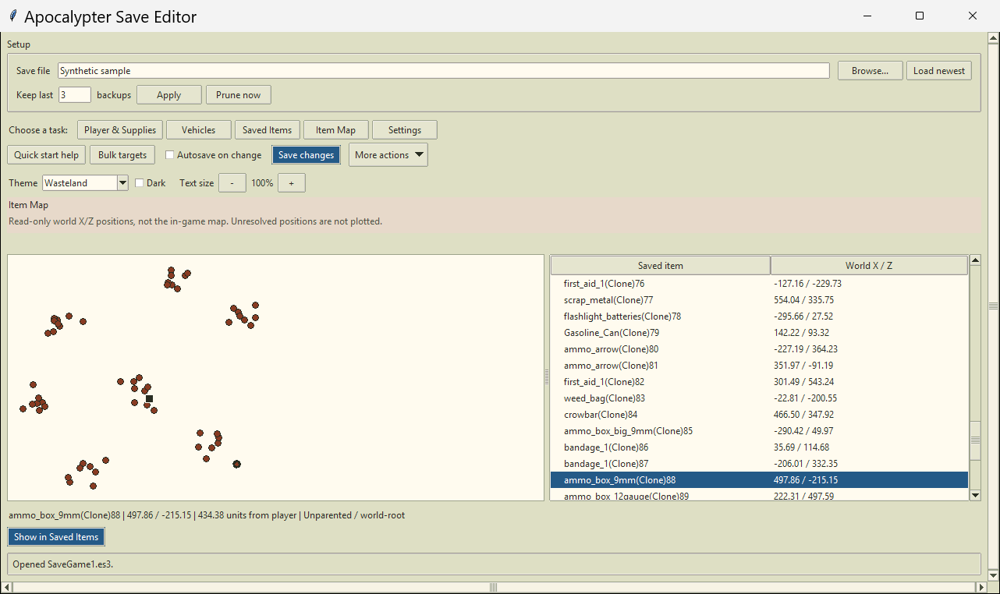
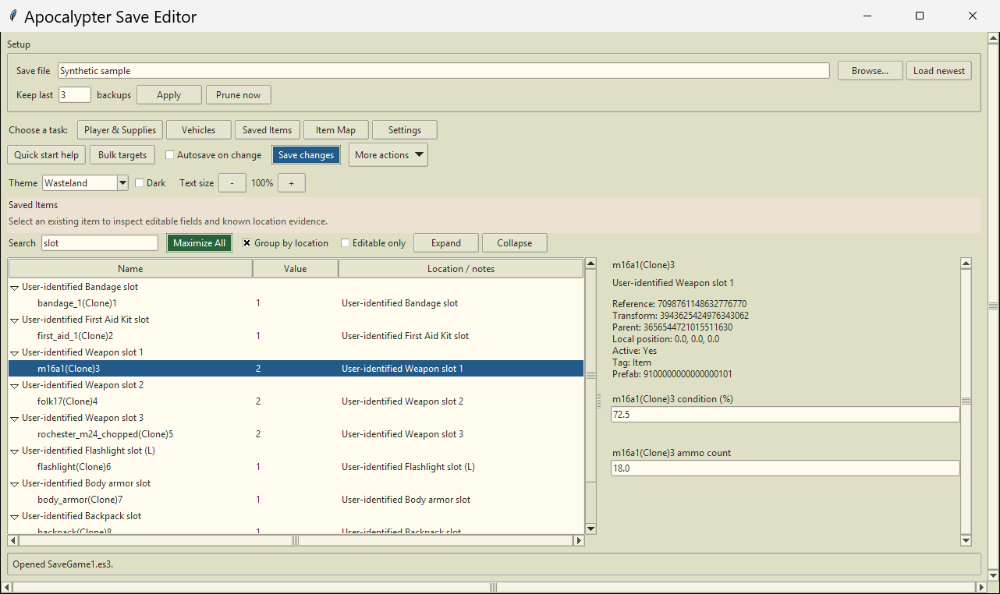
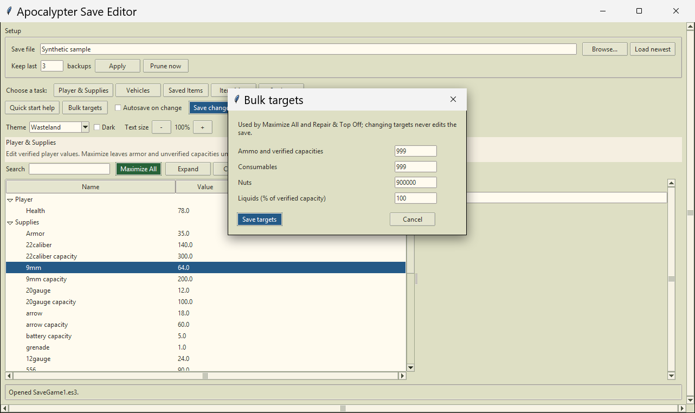

# Apocalypter Save Editor

A native Windows editor for Apocalypter's text-based Easy Save 3 / ES3PlayMaker saves. It edits only verified existing values and preserves unrelated save data.

## Quick start (standalone)

1. Close Apocalypter and download `ApocalypterSaveEditor.exe` from the v2.0.1 or later GitHub release. No Python or browser is needed.
2. Start the exe. It opens the newest numbered `SaveGameN.es3` in `%USERPROFILE%\AppData\LocalLow\SawyerK Games\Apocalypter`, or use **Browse...** to choose a slot or `SaveSettings.es3`. Autoload excludes settings, backups, and exported copies.
3. Choose a task, select a row, and edit its supported values. Hover over controls or rows for help; use **Quick start help** for a short walkthrough.
4. Choose **Save changes**, check the displayed destination, and confirm the overwrite. Alternatively, explicitly enable **Autosave on change** or use **More actions** to review, reset, or export drafts. Exports require a new filename and never replace an existing file.

Keep the game closed while editing. Verify the result in the game after making your own independent backup. The editor does not launch or modify the game.

The exe is unsigned, so Windows SmartScreen may warn. Choose **More info**, then **Run anyway**, or run from source with `run.bat`.

## Screenshots

These screenshots use synthetic data.

| Player and supplies | Saved items | Vehicles |
| --- | --- | --- |
|  |  |  |

| Item map | Equipment slots | Bulk targets |
| --- | --- | --- |
|  |  |  |

[Theme and text-size comparison](docs/screenshots/theme-text-comparison.png) · [80% text](docs/screenshots/text-80.png) · [140% text](docs/screenshots/text-140.png)

## Building from source

Python 3.12 with Tk is required. To run the source, double-click `run.bat` or run `py -3.12 native_gui.py`. To build the standalone executable:

```powershell
py -3.12 -m pip install -r requirements-build.txt
powershell -NoProfile -ExecutionPolicy Bypass -File .\build_exe.ps1
```

The result is `dist\ApocalypterSaveEditor.exe`. Run the synthetic regression suite with `py -3.12 -m unittest discover -s tests -p "test_*.py"`. Tests never write to real saves.

The frozen parity corpus records 459 synthetic inspections and serializations from the prior JavaScript engine at commit `b3001809485f4a39078faa8fb24a8ecff137e82b`; the native tests also check parser, validation, bulk actions, backups, and desktop behavior.

## Main files

| File | Purpose |
| --- | --- |
| `native_gui.py`, `native_theme.py` | Tkinter interface, themes, and text scaling |
| `editor_model.py`, `bulk_actions.py`, `field_views.py` | Drafts, bulk operations, and field help |
| `es3_*.py` | Lossless parser, validation, serialization, items, vehicles, and world transforms |
| `editor_storage.py`, `native_storage.py`, `storage_primitives.py`, `windows_file_safety.py` | Backup policy, atomic saves, and Windows file safeguards |
| `preferences.py` | Validated editor settings |
| `build_exe.ps1`, `ApocalypterSaveEditor.spec`, `requirements-build.txt` | Standalone Windows build |
| `run.bat` | Source-run launcher |
| `tests` | Synthetic regression tests and frozen JavaScript parity fixtures |

## Backups and safety

The setup bar keeps **3** backups per save by default. Opening a supported save immediately creates or verifies a timestamped sibling backup before editing. A confirmed manual save verifies a backup of the preceding bytes before replacing the original. Backups have names like `SaveGame1.es3.20261111T133000123Z.<guid>.original.bak`; an identical verified backup may be reused.

**Keep last** accepts a whole number from 0 to 9,007,199,254,740,991. **Apply** changes the persisted limit and confirms any removal; **Prune now** applies it to the open file. Only exact-format, regular, single-link editor backups of that file are eligible. Unrelated files and unsafe links are not pruned. A recovery point is protected during retention; a limit of 1 rotates it on manual saves.

**0 disables backups**, including on open and manual save, and removes eligible backups when the policy is applied. The editor displays a warning. This deliberately differs from Cargo Hunters' minimum of one backup. An independently exported original copy is never managed by retention.

Autosave is off by default. When enabled it debounces committed edits, toggles, and bulk actions; it does not save while a numeric edit is uncommitted or any draft is invalid. With backups enabled it reuses the verified recovery point rather than creating a backup for every change. Failures pause autosave and retain drafts. A save that succeeded but had a cleanup warning reports both facts and pauses autosave.

Every write validates the edits and checks the source hash for external changes, then flushes a temporary file and uses Windows atomic replacement. Stale files or policies, invalid drafts, missing recovery points, and unsafe links produce explicit errors rather than an unsafe overwrite. Editor settings are stored in `editor_settings.json` next to the exe (or source script); legacy backup, bulk-target, and text-size settings are imported when available. Invalid settings are reported rather than silently replaced.

## Tasks and controls

- **Player & Supplies:** edit verified values. **Maximize All** sets health to 100, hunger/thirst/fatigue/radiation to 0, and recognized ammunition, requested ammunition capacities, and Nuts to their configured targets. It leaves armor and plates unchanged.
- **Vehicles:** repair verified mounted components or top off verified fuel and uniquely mounted liquids; trailers are never treated as fuel tanks. **Repair & Top Off All** also applies configured targets to verified player and item consumables, even when there are no vehicles.
- **Saved Items:** search and group existing instances, inspect their locations and read-only values, and edit verified fields. **Editable only** persists across launches. **Maximize All** also applies to filtered-out items. Unknown or ambiguous values are skipped.
- **Item Map:** inspect a read-only world X/Z coordinate plot and distances from the saved player. Select a marker or list entry and use **Show in Saved Items** to inspect it. It is not a calibrated image of the in-game map; unresolved positions are listed but not plotted.
- **Settings:** edit verified settings present in the opened file. Settings in different files are not synchronized.

**Bulk targets** defaults to Ammo **999**, Consumables **999**, Nuts **900,000**, and Liquids **100%** of each verified capacity. Ammo accepts 0–2,147,483,647; consumables 1–2,147,483,647; Nuts 0–1,000,000; liquid percentages 0–100. The ammo target includes 22-caliber, 9mm, 20-gauge, and arrow capacities, but excludes unrelated capacities and armor. Flashlight battery packs use the ammo target. Food items without saved stack counts are unchanged. Changing targets alone never changes a save.

Choose **Wasteland**, **Desert**, **Nuclear Winter**, or **Apocalypse**, with light or dark colors. Use **Text size − / +** to set 80–140% in 10% steps. These settings affect only the editor, not the save.

## Supported fields and limits

Only fields already present with the expected type are exposed. No new fields, objects, items, or references are invented.

| File | Editable fields |
| --- | --- |
| Game slot | `Player.value.objs.Health`, `Ammo.value.objs.armor` (0-100); inspected ammunition counts and capacities in `Ammo.value.objs` (nonnegative signed 32-bit integers) |
| Game slot | `global.value.objs.Hunger`, `Thirst`, `Fatigue`, and `Radiation` (0-100, higher is worse), bounded by the inspected gameplay FSM clamps |
| Settings | Peaceful mode, disable thirst/hunger, disable fatigue, map cheat, disable insanity, head bob, FPS, footsteps, toggle ADS |
| Settings | Automatic gearbox, automatic clutch, normalized driving input, bloom, and sharpening; only the top-level keys in the opened settings file change |
| Settings | Master, ambient, engine, boss, ambient music and main-menu music volumes (0-1); FOV (30-120) |
| Game slot | Existing item instances, names, exact references, active state, tags, saved parent references, and available local positions (inspection only) |
| Game slot | Existing item stack `Quantity` values (1-2,147,483,647), per-item `ammo` counts (0-2,147,483,647), and verified item `Condition` scalars (0-100%), including loose world items and camp spares |
| Game slot | Exact verified `flashlight_batteries` packs' existing `batteries` count (0-2,147,483,647); bulk actions use the ammo target (default 999) |
| Game slot | Per-item `Liquid` bounded by that item's valid saved `LiquidCapacity`, or an exact verified prefab identity when capacity is absent; units are left as saved units |
| Game slot | Existing `weaponsAmmoInGun` counters by weapon type (nonnegative signed 32-bit integers); these are **not** per-instance ammunition |
| Game slot | Existing vehicle fuel `Liquid` values, bounded by that vehicle's saved `LiquidCapacity` and labeled in L based on the game's player-facing units |
| Game slot | Engine, radiator, and other existing part `Condition` values independently of mounting; attribution to a vehicle still requires a unique saved parent/mount reference |

These are conservative **editor limits**, not claims about every limit enforced by the game. Edits outside these bounds are rejected rather than silently clamped. An already-saved recognized numeric value outside its editor range is shown **read-only with its reason**, rather than blocking opening or unrelated edits. Its original token is preserved, including on export or save. A file containing only such read-only values can still be inspected and backed up. Incompatible recognized field types and ambiguous scalar structures still fail closed.

The survival values are the actual global scalars, not `Player.SanityAdd`/`SanityRemove` triggers. The inspected Hunger, Thirst, Fatigue, and Radiation FSMs clamp them to 0-100. **Player & Supplies → Currency → Nuts** edits the existing `global.Money` integer, used by the HUD and purchases. The editor accepts whole numbers from 0 to 1,000,000; this is a conservative editor limit, **not a verified game maximum**, and in-game earnings can increase the value afterward. Existing values outside the editor's range remain read-only and unchanged. Player Maximize All and Repair & Top Off All set Nuts to the configured target, 900,000 by default. The Armor field remains manually editable, but neither bulk action changes it or any plate count: the game may reset Armor when there are no plates. Direct Sanity remains read-only: the active FSM clamps 0-100, but actual saves contain negative values, and disabled-insanity behavior is not yet resolved. The separate `global.PlayerHealth` copy remains read-only because its load precedence against `Player.Health` is unverified.

Additional driving/graphics toggles were traced to their individual `SaveSettings.es3` Load/Save and UI FSMs. Editing one changes only its explicit top-level settings key; similarly named copies under a slot's `global` wrapper are not synchronized or substituted. Driving copies are displayed read-only in a game slot with instructions to edit the settings file. This is not a promise that duplicate scopes are interchangeable.

Object creation/deletion, ownership transfers, transforms, sanity triggers, save timestamps, and unverified settings remain untouched. Increasing a quantity changes only an existing saved stack; it does not create an item or infer that the object is carried.

The **Saved Items** view lists all existing item objects saved in `newGOArray_Items`, including inactive objects, loose engines, spare parts, supplies, and objects with unknown containers. Filter by saved name, instance reference, or location, then select an item in the table. The adjacent inspector shows its saved identity, available transform details, supported fields, capacity evidence, and read-only reasons.

Different instances with the same friendly name have separate controls and review entries. Changing the selected item or filter keeps other pending edits, including invalid drafts. Autosave updates saved summaries without closing the active inspector. **Reset drafts** discards every draft and returns to the current saved baseline.

World or camp items do not need to be attached to a vehicle or proven to belong to the player before their saved scalar values can be edited. Mounted parts share the same drafts between item and vehicle views, so edits stay consistent with vehicle repair. A parent reference that cannot be resolved is still shown as unknown; this list is not presented as a carried-inventory count.

When an item's saved parent appears uniquely in a matched vehicle's `es3Prefab.refs` map, its location says **Vehicle-associated** unless a specific mount is independently verified. General reference-map membership does not distinguish mounting from storage or prove player possession. Ambiguous maps stay unresolved. General associations never add component-repair or vehicle-top-off targets; those actions require explicit mount/tank evidence.

**Equipment slots and saved-item coordinate plot** identifies the user's supplied slot references only when the saved Player object and transform match the observed player anchor. An item is listed in a slot only with the exact parent; Bandage and First Aid additionally require zero local position as specified by the user. An unlisted item does not prove the slot is empty. The user's trailer-container and box-in-trunk labels require matching vehicle prefab and unique saved prefab-reference evidence. These are user-identified locations, not inferred universal identifiers; the box is not the trunk root. Exact parent chains, not item names, determine those labels.

The read-only plot uses saved Unity world X/Z coordinates, not the game's map image. The saved player's root Transform provides its world position; a root object's local position is world position, while a child position is relative to its parent. The editor composes position, rotation and scale only through uniquely identified saved transforms. Missing or malformed parents/transforms, duplicate IDs and cycles stay unresolved and are omitted, not plotted at zero. Distances are horizontal world units from the saved player, not verified meters. The real game has map-related objects, but a calibrated mapping between these coordinates and the game map has not been verified. Select a marker or use the item list to inspect an overlapping item. Plotting and slot inspection do not move or create anything.

Adding, moving, or equipping objects is not currently supported. It would require verified prefab creation, unique ES3 references, transform hierarchy and sibling state, inventory/slot relationships, and any gameplay FSM state; merely changing coordinates or parents could corrupt a save or be overwritten on load.

Selecting an item with no safely editable fields explains the limitation. Available unsupported scalar values are shown read-only with reasons. In the inspected saves, loose engines and radiators save `Condition`, and ammo boxes save their own `ammo` count. The pictured Small wheel T1, Small wheel T2, and Armored Street Wheel save condition as a standalone float keyed by the exact instance name: these are editable only with a unique item name and reference and the verified matching prefab. Their scalar has no owner reference, and its name alone does not establish mounting. Use **Saved Items** or that view's **Maximize All**; Vulture wheels at uniquely resolved wheel-hinge parents are also included in vehicle repair. A wheel at the physics-lock parent is not treated as mounted. Other wheels, exhausts, tools, unverified liquids, and growing-item liquids may remain read-only. Grip, radiator cooling, and supercharger power are prefab/gameplay properties, not verified per-instance saved scalars. Unknown timers, growth values, gearing, and purchase-state fields remain unchanged.

Missing-capacity mappings were verified against the installed game's actual prefab IDs and `LiquidAmount` FSM variables:

| Saved prefab base name | Exact ES3 prefab ID | Capacity (saved units) |
| --- | --- | --- |
| `MotorOil_Can_Small` | `5864412579365047585` | 5 |
| `Gasoline_Can` | `6858519991654959144` | 20 |
| `Water_Can_Plastic` | `4230013134874058846` | 13 |
| `Diesel_Barrel` | `608293236901033563` | 150 |
| `MotorOil_Can_Big` | `5623108999256334996` | 30 |
| `radiator_medium_race` | `2169926468007209799` | 14 |
| `Diesel_Can` | `9030660213298172268` | 20 |
| `radiator_medium` | `8205777586039224731` | 9 |
| `radiator_motorcycle` | `2705209445545947911` | 3 |
| `radiator_small` | `5669857674379848146` | 6 |
| `radiator_truck` | `5421126813566889844` | 18 |
| `radiator_truck_big` | `2031828300969920981` | 24 |
| `radiator_truck_ultra` | `3587043590766116916` | 28 |
| `594cc I2 23HP 39Nm Gasoline` | `3634296406011431456` | 2 |
| `3L I5 87HP 172Nm Diesel` | `6089072345908897270` | 5.1 |
| `3.8L V6 165HP 285Nm Gasoline` | `5945172545298182391` | 6 |
| `3.7L I6 145HP 292Nm Gasoline` | `624016700395080820` | 5.3 |
| `5.8L I6 120HP 356Nm Diesel` | `7861181815379186` | 7 |
| `18L V8 335HP 1700Nm Diesel` | `4167795411855106502` | 16 |
| `2.8L V6 115HP 183Nm Gasoline` | `7876660059110608148` | 5 |
| `5.2L V8 230HP 340Nm Gasoline` | `9035087652290305727` | 7 |
| `7L V8 355HP 569Nm Gasoline` | `5126044545507921876` | 9 |
| `1.3L v2 55HP 94Nm Gasoline` | `884780215855984285` | 3.3 |
| `1.2L I4 59HP 87Nm Gasoline` | `6758790462075466819` | 3.3 |
| `2.3L I4 89HP 165Nm Gasoline` | `374403439354623823` | 3.9 |
| `7L I6 165HP 542Nm Diesel` | `1298474360822390476` | 7.5 |
| `8.2L V8 400HP 746Nm Gasoline` | `4674809622967151223` | 10 |
| `11.5L V12 274HP 854Nm Gasoline` | `873555013045931076` | 13 |

Fallback requires the exact base name and matching prefab IDs in **both** the saved object and its reference-matched scalar owner. The inspector displays the capacity source. A present capacity always takes precedence; an invalid present capacity is never replaced with a prefab guess. No `LiquidCapacity` field is inserted into the save. Other or conflicting prefab identities stay read-only. These mappings reflect the inspected game assets, not an assurance for future versions that reuse IDs with changed behavior.

Duplicate object references across item and vehicle arrays are marked ambiguous and withheld from editing. The `akms(Clone)50` instance is labeled by its saved identifier (AKMS); it is not renamed AK47. Its loaded-round counter remains weapon-type scoped; an ammo box's own `ammo` value is separately instance-scoped.

The **Saved items** tab omits the separate **Ammunition by weapon type** field section. Carried ammunition remains editable under **Player & supplies → Supplies**. The underlying weapon-type counters are preserved; existing bulk actions still apply their documented targets.

The **Vehicles** view joins each vehicle to its scalar record by a unique matching ES3 reference. Fuel is editable only when both `Liquid` and `LiquidCapacity` are valid and consistent; the save has no explicit unit label, so L follows the game's player-facing units as described by the user. Engine, radiator, and exhaust condition is shown only when its saved transform parent matches that vehicle's corresponding mount. The three verified wheel prefabs also appear when their unique parent matches a verified Vulture wheel hinge and both vehicle prefab identities agree. A separate vehicle-body damage/condition scalar was not found. Unresolved or ambiguous associations remain read-only with an explanation; the editor does not spawn, delete, or relink objects.

## Format and compatibility

Inspected against local `SaveGame1.es3`, `SaveGame2.es3`, and `SaveSettings.es3`, with additional read-only assembly and prefab/FSM checks on November 12, 2026. No explicit save-schema marker was observed; support is **structural**, not a guarantee for every release.

Mapping evidence in the installed Unity 2020.3.49f1 `data.unity3d`: `sharedassets1.assets` oil/gasoline/water GameObjects 13681/8948/20904 have matching ES3Prefab IDs and `LiquidAmount` FSMs 105672/104007/108401; their live capacity variables are 5/20/13. `level1` survival FSMs 11831/11833/11842/11836 clamp Hunger/Thirst/Fatigue/Radiation from 0 to 100. Per-key settings Load/Save FSMs 13403/12636/11994/12123/13387 correspond to automatic gearbox/autoclutch/normalized input/bloom/sharpen. These assets were inspected in memory only; the editor needs no installation assets at runtime.

Additional `sharedassets1.assets` evidence: Diesel Barrel and big oil can GameObjects 31081/32544 have `LiquidAmount` FSMs 112013/112440 with capacities 150/30; the medium race radiator GameObject 24474 has a cap-child `LiquidAmount` FSM 109626 with capacity 14. Wheel GameObjects 19728/24165/10145 use `saveItemVar` FSMs 103785/103388/104446 to save and load `Condition` by object name; their HUD FSMs 107940/109448/104440 identify the three wheel labels. Vulture GameObject 9130's ES3Prefab 108980 maps the verified wheel-hinge keys to four transforms, separately from its PhysicsLock transform. A current save value matching a screenshot is suggestive, not proof of the same instance.

Additional liquid evidence: engine GameObjects 8943/12433 have cap-child `LiquidAmount` FSMs 107368/106676 that clamp engine oil at 2/6; radiator GameObjects 20476/20449 have cap FSMs 108196/108178 clamping water at 6/3. Their save/load FSMs persist the matching liquid value. Other engine/radiator IDs in the table were checked against their corresponding cap, clamp, and save/load FSMs. Diesel_Can GameObject 22228 has `LiquidAmount` FSM 108841 with capacity 20. Decimal capacities in the table round to Unity's stored single-precision floats; the editor also accepts their nine-digit serialized representations.

`first_aid_1` and `weed_bag` expose their existing stack `Quantity` under **Saved Items** and use the configured consumables target for bulk actions. The First Aid prefab's item-use UI displays “Health +50”; that is its per-use effect, not the editable stack count. The Weed prefab displays `Weed` and formats its saved `Quantity` as a piece count. A First Aid parent that resolves only through a vehicle prefab reference is labeled vehicle-associated, not claimed to be a particular mounted part or box; unresolved parent/container references remain unresolved. `plant_weed` is a distinct growing object, not the pictured Weed stack. `blastlance_1` objects in the inspected save have a zero `Quantity`, but prefab save/load FSM 110681 does not establish it as an ammunition counter, so it remains read-only; plant/dew-collector liquids without a verified capacity also remain unchanged.

Currency evidence: `level1` HUD FSM 11830 converts global `Money` to its HUD text; global save/load FSM 13238 saves and loads the `global` record. `sharedassets1.assets` purchase FSM 103214 labels prices “Nuts” and compares `Money` with `BuyValue`; sell FSM 103560 adds `PriceInt` to `Money`. The editable ceiling is not derived from those actions. Real game reload of an edited currency value has not been verified.

Bulk counter evidence: `sharedassets1.assets` bandage GameObject 18626 save/load FSM 104971 persists `Quantity`; repair-box Small/Medium/Large GameObjects 34453/28030/27034 use save/load FSMs 103376/105185/111705 for the `UseRepair` quantity. Ammo-box save/load FSMs persist `ammo`, including 103900 (20 gauge), 111217 (9mm), and 105996 (7.62mm). The editor requires the exact verified prefab name and matching object/owner prefab IDs before applying these item count targets. Other counters remain unchanged.

First Aid and Weed stack evidence: `first_aid_1` prefab ID `3955095449936337101` has a `Quantity` comparison/destruction FSM and save/load FSM 111458 that persists `Quantity`; UI FSM 103333 identifies “First Aid” and “Health +50”. `weed_bag` prefab ID `2856772050428381491` uses `Quantity` for its displayed piece count, its use FSM reads that counter, and save/load FSM 112107 persists it. The displayed benefits are prefab behavior; only the existing saved count is editable.

Repair & Top Off's additional verified consumables include arrow prefab `3766863323530176910` (`ammo`, save FSM 111942), sanity pills `4398581480533230246` (`Quantity`, FSM 108906), cigarette `7947724335221001397` (FSM 111069), and cigar `6706846953073870613` (FSM 105536). Item targets require matching exact prefab name and object/owner prefab IDs. Inspected cooked/raw meats, cooked animals, and `dogfood_can` have food-use FSMs but no verified saved stack counter; they are left unchanged rather than inventing quantities or spawning objects.

The consumable-count re-audit also identified `flashlight_batteries` prefab `6027655925999442117`: save/load FSM 107581 persists the integer `batteries`, UI FSM 107578 displays that count, and pickup FSM 107576 transfers units into player `ammo_battery` and subtracts them from the pack. These packs are editable under **Saved Items** and included under the ammo target (default 999). A missing, invalid, or ambiguously owned pack counter is never created or substituted. The bulk actions cover all 26 verified item-counter prefab variants, all 10 recognized carried-ammo counts and recognized weapon-type counters within their respective scopes.

Unsupported food is explicit: the inspected saves contain `Lizard_Dead`, `Scorpion_Small_Dead`, and `Lizard_cooked` instances without matched count records. Their food-use actions, plus those for rats, spiders, raw/cooked meats and `dogfood_can`, consume/destroy individual objects instead of loading a saved stack count. Turning those into 999 units would require creating objects, which this editor does not do. Maggot-farm `meat` is production/feeding state controlled by farm/timer FSMs, not a verified consumable stack; Blastlance `Quantity` is not established as ammunition. These values, growth/timers, Armor/plates, and other ammunition capacities remain unchanged.

Settings use ordinary typed entries such as:

```json
{"peacefulMode":{"__type":"bool","value":false}}
```

PlayMaker data uses a nonstandard inline value, for example:

```text
{"Health":{"__type":"float"100}}
```

**Do not run the game save through a standard JSON parser and serializer.** The parser understands both formats and records exact scalar source spans. Serialization replaces only edited numeric or boolean tokens, preserving unknown content, 64-bit reference literals, ordering, whitespace, line endings, escapes, and a UTF-8 BOM. A no-change roundtrip returns identical text; original-copy export uses the exact baseline bytes.

Only UTF-8 text up to 20 MiB is accepted. Invalid UTF-8, encrypted/binary data, duplicate keys, malformed syntax, excessive nesting, unknown files, and incompatible recognized field types are rejected explicitly. Opening applies the saved recovery/retention policy without modifying the source. Only confirmed manual Save or explicitly enabled autosave replaces the source.

## Troubleshooting

- **No save found:** use **Browse...** and select an existing `.es3` file. The game installation directory is not the save directory.
- **Save changed externally:** close the game, reopen the current save, and restage the desired edits; stale data is never overwritten.
- **Autosave stopped or backup cleanup is incomplete:** resolve the displayed filesystem or backup error, apply retention again if needed, then turn autosave off and on to retry.
- **Settings cannot be read or saved:** check permissions for `editor_settings.json` next to the executable. Linked, malformed, or invalid settings are rejected.
- **Some controls are off-screen:** use the outer scrollbars, resize the window, or decrease text size. The inspector has its own vertical scrollbar.
- **An item has no editable fields or map marker:** its saved data, identity, capacity, or transform may not be sufficiently verified. It remains unchanged.
